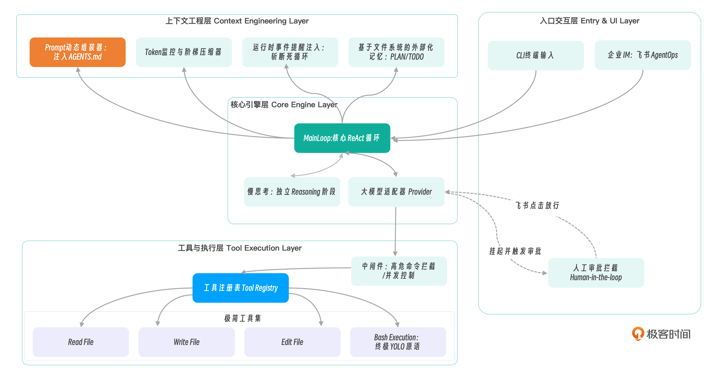
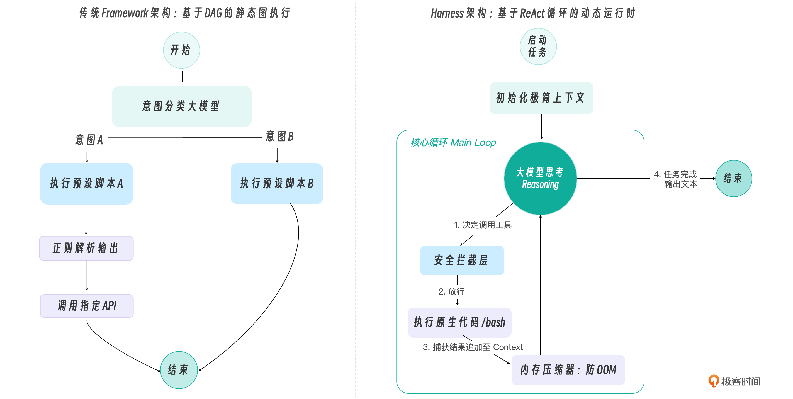

# 学习笔记：从 0 开始构建 Agent Harness

<!-- |   |   | -->
<!-- | - | - | -->

> 来源：腾讯学堂培养项目《从 0 开始构建 Agent Harness | 极客时间》（作者 Tony Bai）  
> 链接：<https://sdc.qq.com/s/Zkma1k?scheme_type=mooc\&mooc_course_id=uM2LYJ8G>  
<!-- > 说明：学堂接口只返回课程简介，未返回 24 讲正文。本笔记依据课程简介整理，标注"（补充）"的内容为个人工程经验补充，非课程原文。 -->

---

## 一、什么是 Harness

**Harness 就是给大模型写的"微型操作系统"。** 模型只负责思考，上下文管理、工具调度、安全拦截、状态持久化都由 Harness 在模型外面完成。

| OS 概念 | Agent 对应    | Harness 要干的事      |
| ----- | ----------- | ----------------- |
| CPU   | 大模型         | 只负责推理和规划          |
| RAM   | 上下文窗口       | 内存回收（压缩、降级）       |
| 外设    | Shell、文件、网络 | 统一注册、调度、拦截        |
| 中断    | 人工审批、超时     | Human-in-the-loop |

---

## 二、为什么需要 Harness

| 现象                   | 根因           | Harness 解法               |
| -------------------- | ------------ | ------------------------ |
| 读 3000 行日志就 Token 超限 | Token溢出却无法精细化干预（**上下文失控 ContextBloat**） | 阶梯降级压缩（Compaction）       |
| 同一个错误命令重复跑 10 遍      | 提示词对长程任务彻底失效（**状态失控 DoomLoop**）       | 运行时 Reminders 打断         |
| 差点执行 `rm -rf ./`     | 缺乏底层的物理拦截防线（**边界失控 YOLODisaster**）      | Middleware 拦截 + 人工审批 |

课程暗线是"框架坍塌，Harness 崛起"：模型自己会规划和调工具后，LangChain、AutoGen 这类重框架反而成了黑盒，状态藏在内存里，开发者插不上手。“大道至简”的核心：极简工具法则 Minimal Toolset、状态外部化 Externalized State、YOLO哲学与防御纵深。Harness架构图：

---

## 三、知识梳理

### 1. 核心引擎（The Core Engine）

- Harness架构 ReAct 循环：思考 → 调用工具 → 观察 → 再思考

- 多模型适配层：接 Claude 和 OpenAI 兼容 API
- 引入 Thinking 慢思考机制，提升复杂任务规划成功率

### 2. 工具层(Action & Tools)

- Tool Registry 统一注册工具
- 极简工具哲学：工具少而精，不堆几十个工具描述
- 健壮的 Edit 工具：支持多级模糊匹配
- 用 Go 并发做并行工具执行

### 3. 上下文工程（Context Engineering）

- 系统提示词动态组装
- 超长文本阶梯降级压缩（Compaction）
- **记忆和待办外部化到文件系统**，不用内部状态机

### 4. 稳定性与多智能体(Safety & Coordination)

- Reminders 斩断死循环
- Middleware 拦截危险操作，高危动作走人工审批
- Subagent 隔离复杂任务，避免污染主上下文

### 5. 可观测与度量(Observability & Evaluation)

- Tracing 链路追踪
- 成本审计
- 自动化 Benchmark，用数据衡量每次改动是否变好

### 6. 端到端实战(End-to-End Practice)

- 一个 CLI 工具
- 一个飞书群里的 AgentOps 运维自动化助手

---

## 四、五条核心设计原则

1. **不调包**：核心循环自己写，保证可控
2. **工具极简**：少而强
3. **状态外部化**：记忆、待办存文件系统，可审计、可恢复、可人工介入
4. **上下文当内存管**：必须有回收策略
5. **先度量再优化**：没有 Benchmark 就没有进步

<!-- ## 五、学习建议

- **优先级**：第 3 章（上下文）和第 4 章（稳定性）最值得精读，所有 Agent 项目都会遇到
- **学习方式**：跟着敲 go-tiny-claw。看懂 ReAct 循环 + Tool Registry，就掌握了骨架的大头
- **语言**：代码是 Go。如果主要用 Python / TF，读懂设计即可，不必强行学 Go
- **交付物**：go-tiny-claw 完整源码，含 ReAct 循环、多模型适配、上下文压缩、死循环检测、链路追踪
- （补充）若要做推荐分析自动化 Agent，如自动跑 AUC 报表、排查训练任务，第 3、4、5 章可直接借鉴 -->

---

## 五、常见问题

### A. 概念理解

**Q1.** 用 OS 类比解释：大模型、上下文窗口、本地操作、Harness 分别对应什么？Harness 为什么不负责"教模型怎么想"？

参考思路
  
CPU / RAM / 外设 / OS 内核。Harness 的职责是资源调度和保护（内存回收、硬件调度、系统中断），推理能力来自模型本身。  

**Q2.** 为什么说"框架越重，失控越狠"？重框架和 Harness 的核心差别是什么？

参考思路
  
重框架把状态藏在内存、塞大量工具描述，开发者无法观测和介入。Harness 强调自己掌握循环、状态外部化、工具极简，可控可观测。  

**Q3.** 三个典型翻车现象（Token 超限、重复命令死循环、危险命令）分别对应 Harness 的哪个机制？

参考思路
  
Compaction 压缩；Reminders 打断；Middleware 拦截 + 人工审批。  

### B. 设计思考

**Q4.** ReAct 循环的终止条件应有哪些？只靠模型输出"完成"够吗？

参考思路（补充）
  
不够。还需要最大轮数、Token 或成本预算、超时、死循环检测、人工中断，防止模型一直不收敛。  

**Q5.** 做上下文压缩时，哪些信息必须保留？哪些可以降级或丢弃？什么叫"阶梯降级"？

参考思路（补充）
  
必须保留：任务目标、用户约束、关键决策、未完成待办。可降级：已读过的长日志和文件内容，先保留摘要，再保留引用，最后丢弃。阶梯降级指按"旧、大、低价值"的顺序逐级压缩，而不是一次性全截断。  

**Q6.** 为什么要把记忆和待办放到文件系统，而不是放在内存状态机里？列出至少 3 个好处。

参考思路
  
可审计（人能直接看）、可恢复（进程崩溃或重启后可续跑）、可人工修改、可跨 Subagent 共享、不占上下文。  

**Q7.** 如何判定"死循环"？只看"相同命令重复 N 次"可靠吗？

参考思路（补充）
  
不够可靠。更稳的做法是：相同命令 + 相同报错 + 环境状态无变化，连续多次才判定。判定后注入 Reminder 提示模型换策略，仍无效再升级为中断或人工介入。  

**Q8.** 哪些工具调用必须走人工审批？审批机制放在哪一层最合适，为什么？

参考思路（补充）
  
删除、覆盖写、网络外发、生产环境操作、花费较大的调用。放在 Middleware 层，对所有工具统一生效，不依赖模型自觉，也不需要每个工具各写一遍。  

**Q9.** Edit 工具为什么需要"多级模糊匹配"？只做精确字符串匹配会出什么问题？

参考思路（补充）
  
模型生成的 old_string 常有空白、缩进、换行的细微差异，精确匹配会频繁失败，导致重试和死循环。需要逐级放宽匹配（精确 → 忽略空白 → 行级模糊），同时保证匹配唯一，避免误改。  

**Q10.** Subagent 解决了什么问题？什么任务适合派给 Subagent？

参考思路
  
隔离复杂任务，避免中间过程污染主上下文。适合搜索大量文件、跑长日志分析等"过程长、只需要结论"的任务。  

### C. 工程实践

**Q11.** 工具并行执行时，要注意哪些并发风险？

参考思路（补充）
  
读操作可并行；写同一文件、有依赖顺序的命令必须串行。结果要按调用顺序回填给模型。  

**Q12.** 没有 Benchmark 时，怎么知道改了上下文压缩策略是变好还是变差？你会设计哪些指标？

参考思路（补充）
  
任务成功率、平均轮数、Token 和成本、死循环触发率、人工介入次数。用固定任务集做回归，对比改动前后。  

**Q13.** Tracing 至少应该记录哪些字段，才能事后复盘一次 Agent 失败？

参考思路（补充）
  
每步的模型输入输出摘要、工具名和参数、耗时、Token 用量、错误信息、触发的 Reminder 或拦截事件、会话 ID 和步骤 ID。  

### D. 迁移应用

**Q14.** 假设要做一个"自动排查训练任务 QPS 下降"的 Agent，请列出你会设计的工具集（不超过 5 个）、必须拦截的操作、需要外部化的状态。

参考思路（补充）
  
工具：读日志、查指标、读配置、执行只读命令、写排查报告。拦截：重启或终止任务、改配置、删数据。外部化：排查假设清单、已验证结论、待办项。  

---

<!-- ## 七、学习打卡

- [ ] 通读课程简介，理解 Harness 定位
- [ ] 第 1 章：跑通 ReAct 循环
- [ ] 第 2 章：实现 Tool Registry 和 Edit 工具
- [ ] 第 3 章：实现上下文压缩（重点）
- [ ] 第 4 章：死循环检测 + 审批拦截（重点）
- [ ] 第 5 章：加 Tracing 和 Benchmark
- [ ] 第 6 章：端到端串讲
- [ ] 自测题 Q1–Q14 全部自答一遍 -->
